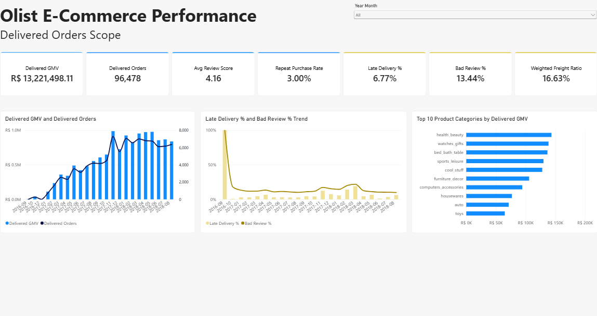

# Olist E-Commerce End-to-End Analytics (MySQL & Power BI)

Analisis end-to-end atas dataset publik **Olist** (`db_olist`): **MySQL** untuk audit data, view per pesanan, analisis keterlambatan, ulasan, rasio ongkir, dan *repeat purchase*; **Power BI** untuk model bintang dan *dashboard* interaktif.

## Pertanyaan Bisnis Utama

Apakah keterlambatan pengiriman menurunkan kepuasan pelanggan (skor ulasan dan proporsi ulasan buruk), dan apakah itu berkaitan dengan pembelian ulang serta keputusan operasional pada pesanan *delivered* di Olist?

## Ringkasan Eksekutif

- Hanya **6.77%** dari 96,470 pesanan *delivered* yang terlambat, tetapi **62.4%** pesanan terlambat ber-ulasan mendapat skor buruk (≤ 2), dibanding **9.2%** pada pesanan tepat waktu. Skor rata-rata turun dari **4.29** menjadi **2.27**.
- Pesanan terlambat menyumbang **32.5%** dari seluruh ulasan buruk, dan pola yang sama muncul di SP, RJ, dan MG. Pelanggan yang pesanan pertamanya terlambat membeli ulang sedikit lebih jarang (**2.52% vs 3.04%**); repeat rate keseluruhan hanya **3.00%**.
- Keterlambatan lebih berkaitan dengan waktu kurir ke state tujuan daripada proses penjual: RJ memiliki 12.8% pesanan tetapi 22.9% keterlambatan, dan penjual tidak terkonsentrasi. Prioritas: evaluasi mitra kurir dan estimasi tiba untuk RJ (lalu BA), serta uji bundling atau ambang ongkir pada kategori bervolume besar dengan rasio ongkir tinggi.
- Jika hubungan ini sepenuhnya sebab-akibat, menekan keterlambatan dapat menghindari hingga ±3,390 ulasan buruk (batas atas ilustratif).

**Summary (English):** Only 6.8% of 96,470 delivered orders arrive late, yet 62.4% of those get a bad review (score ≤ 2) versus 9.2% for on-time orders, and late orders generate 32.5% of all bad reviews. The pattern holds in SP, RJ, and MG. Delays are associated with courier transit time, concentrated in RJ, rather than with a few sellers.

---

## Sumber & Cakupan Data

- **Sumber:** [Brazilian E-Commerce Public Dataset by Olist](https://www.kaggle.com/datasets/olistbr/brazilian-ecommerce) di **Kaggle** (data 2016–2018; data mentah tidak disertakan di repositori ini).
- **Cakupan:** Metrik pendapatan, pengiriman, ongkir, ulasan, dan *repeat purchase* memakai pesanan berstatus `delivered`. Status lain hanya dipakai pada audit. Tren bulanan memakai bulan lengkap saja (2017-01 s.d. 2018-08).
- **Mata uang:** semua nilai uang dalam **R$ (real Brasil, BRL)**.

---

## Ringkasan KPI Utama

| KPI | Nilai | Definisi / Cakupan |
| :--- | :--- | :--- |
| **Delivered GMV** | **R$ 13,221,498.11** (96,478 pesanan) | Jumlah `price` item pada pesanan *delivered*, tanpa ongkir |
| **Avg Review Score** | **4.16** | Rata-rata skor (1–5) pesanan *delivered* ber-ulasan |
| **Late Delivery %** | **6.77%** | 6,534 dari 96,470 pesanan *delivered* bertanggal terima valid |
| **Estimasi vs aktual** | **24.4 hari** vs **12.5 hari** | Rata-rata estimasi sejak pembelian vs lama kirim aktual (selisih rata-rata −11.88 hari); pesanan terlambat rata-rata **10.6 hari** melewati estimasi |
| **Skor ulasan vs ketepatan** | **4.29** (tepat waktu, 89,442 pesanan) vs **2.27** (terlambat, 6,381 pesanan) | Hanya pesanan yang punya ulasan (494 tepat waktu dan 153 terlambat tidak punya ulasan) |
| **Bad Review %** | **12.8%** | Pesanan *delivered* ber-ulasan dengan skor rata-rata ≤ 2 (12.77% per pesanan; 12.81% per ulasan) |
| **Weighted Freight Ratio** | **16.63%** | Total ongkir R$ 2,198,276 ÷ GMV R$ 13,221,498 |
| **Repeat Purchase Rate** | **3.00%** | 2,801 dari 93,358 pelanggan unik (`customer_unique_id`), sepanjang periode data |



---

## Temuan Utama & Rekomendasi Bisnis

### 1. Kualitas Data & Cakupan (`01_data_cleaning_and_audit.sql`)
- **Nilai produk juga ada pada status non-*delivered*** (`shipped`, `canceled`, `invoiced`, `processing`). Memisahkan *delivered* mencegah overestimasi pendapatan terealisasi.
- **8 pesanan *delivered* tanpa tanggal terima** dikeluarkan dari analisis keterlambatan (96,478 → 96,470).
- **Impor awal tabel `products` terpotong di 4,096 baris**, sehingga 98,511 dari 112,650 item (87.4%) tidak punya produk dan hampir seluruh GMV berlabel `unknown`. Masalah ini terdeteksi lewat ranking kategori, tabel diimpor ulang, dan audit kelengkapan impor ditambahkan.

### 2. Keterlambatan, Ulasan & Konsentrasi (`03_business_and_operational_analysis.sql`)
- **Pengiriman secara keseluruhan:** estimasi tiba rata-rata 24.4 hari, aktual 12.5 hari. Estimasi sangat longgar, namun 6.77% pesanan tetap terlambat, dengan rata-rata 10.6 hari melewati estimasi, jadi keterlambatannya tidak ringan.
- **Gradasi keterlambatan:**

| Kelompok | Pesanan | Skor rata-rata | Ulasan buruk (≤ 2) |
| :--- | ---: | ---: | ---: |
| Tepat waktu / lebih cepat | 89,442 | 4.29 | 9.2% |
| Telat 1–3 hari | 1,852 | 3.29 | 32.2% |
| Telat 4–7 hari | 1,748 | 2.11 | 67.6% |
| Telat > 7 hari | 2,781 | 1.70 | 79.2% |

- **Uji ketahanan (skor rata-rata / % ulasan buruk):** pola turun-naik yang sama muncul di tiga state terbesar (setiap sel ≥ 152 pesanan).

| Kelompok | Nasional | SP | RJ | MG |
| :--- | :--- | :--- | :--- | :--- |
| Tepat waktu | 4.29 / 9.2% | 4.33 / 8.6% | 4.24 / 10.9% | 4.28 / 9.5% |
| Telat 1–3 hari | 3.29 / 32.2% | 3.40 / 29.1% | 3.04 / 40.3% | 3.32 / 30.5% |
| Telat 4–7 hari | 2.11 / 67.6% | 2.19 / 64.6% | 1.91 / 74.7% | 1.97 / 69.7% |
| Telat > 7 hari | 1.70 / 79.2% | 1.84 / 75.5% | 1.53 / 83.8% | 1.74 / 77.8% |

- **Dampak (skenario bersyarat):** 6,381 pesanan terlambat ber-ulasan (±6.7% pesanan ber-ulasan) menyumbang **32.5%** seluruh ulasan buruk. Jika hubungan keterlambatan dan ulasan buruk sepenuhnya sebab-akibat dan seluruh keterlambatan bisa dihilangkan, sekitar **3,390** ulasan buruk bisa dihindari (batas atas).
- **Konsentrasi per state tujuan:** keterlambatan terpusat pada state bervolume besar dan berwaktu kurir panjang. Lima state teratas menyumbang 69.7% keterlambatan.

| State tujuan | Pesanan | % terlambat | % dari semua keterlambatan | Hari penjual | Hari kurir |
| :--- | ---: | ---: | ---: | ---: | ---: |
| SP | 40,494 | 4.5% | 27.9% | 3.1 | 5.6 |
| RJ | 12,350 | 12.1% | 22.9% | 3.3 | 11.9 |
| MG | 11,354 | 4.6% | 7.9% | 3.2 | 8.7 |
| BA | 3,256 | 12.2% | 6.1% | 3.3 | 16.0 |
| RS | 5,344 | 6.1% | 5.0% | 3.2 | 12.0 |
| MA | 717 | 17.4% | 1.9% | 3.6 | 17.9 |
| AL | 397 | 21.4% | 1.3% | 3.4 | 21.1 |

  SP besar karena volumenya (42.0% pesanan, tingkat terlambat di bawah rata-rata). RJ adalah masalah utama: 12.8% pesanan tetapi 22.9% keterlambatan, dan 58% pesanan terlambat ber-ulasan di RJ melewati 7 hari (SP 30%, MG 35%). AL dan MA punya persen tertinggi, tetapi hanya 3.2% dari seluruh keterlambatan. Waktu proses penjual hampir sama di semua state (2.8–3.7 hari), sedangkan waktu kurir berkisar 5.6 sampai 25.6 hari.
- **Konsentrasi per penjual:** dari 2,970 penjual, keterlambatan hanya sedikit lebih terkonsentrasi daripada volume pesanan.

| Top N penjual (menurut jumlah keterlambatan) | % dari semua keterlambatan | % dari semua pesanan |
| :--- | ---: | ---: |
| 10 | 15.7% | 13.7% |
| 50 | 38.1% | 32.0% |
| 100 | 50.5% | 42.0% |
| 200 | 65.4% | 55.2% |
| 500 | 84.7% | 73.4% |

- **Rekomendasi:**
  1. Evaluasi mitra kurir dan akurasi estimasi tiba untuk state tujuan bervolume besar dengan keterlambatan tinggi, terutama **RJ**, lalu **BA**. Sebagai skenario ilustratif, jika persen terlambat RJ turun dari 12.1% ke sekitar 4.5% (tingkat SP/MG), sekitar 940 pesanan terlambat (±14% dari total) bisa dihindari.
  2. Tinjau estimasi tanggal tiba per state: estimasi nasional rata-rata terlalu longgar (24.4 vs 12.5 hari), tetapi sebagian pesanan di rute lambat tetap melewatinya.
  3. Jadikan SLA penjual prioritas kedua, karena keterlambatan menyebar di banyak penjual. State kecil dengan persen tinggi (AL, MA) cukup dipantau.

### 3. Beban Ongkos Kirim & Kategori Produk
- **Keseluruhan:** ongkir setara **16.63%** dari nilai produk (R$ 2,198,276 dari GMV R$ 13,221,498).
- **Sepuluh kategori terbesar** menyumbang 62.4% GMV (lima teratas 39.7%):

| Kategori | GMV (R$) | % GMV | Ongkir vs harga |
| :--- | ---: | ---: | ---: |
| health_beauty | 1,233,132 | 9.3% | 14.5% |
| watches_gifts | 1,166,177 | 8.8% | 8.4% |
| bed_bath_table | 1,023,435 | 7.7% | 19.7% |
| sports_leisure | 954,853 | 7.2% | 17.1% |
| computers_accessories | 888,725 | 6.7% | 16.2% |
| furniture_decor | 711,928 | 5.4% | 23.7% |
| housewares | 615,629 | 4.7% | 23.2% |
| cool_stuff | 610,204 | 4.6% | 13.4% |
| auto | 578,967 | 4.4% | 15.6% |
| toys | 471,286 | 3.6% | 16.1% |

- **Rasio ongkir tertinggi** (kategori ≥ 500 item): `electronics` 29.5% (2,729 item, GMV R$ 155,044), `office_furniture` 25.0%, `furniture_decor` 23.7%, `housewares` 23.2%, dan `telephony` 22.4%. Rasio tinggi muncul pada barang berharga satuan rendah (rata-rata `electronics` ±R$ 57 per item) dan, kemungkinan, barang besar (mis. furnitur); keterkaitan dengan berat atau ukuran produk belum dianalisis. Kategori berharga tinggi seperti `watches_gifts` hanya 8.4%.
- **Rekomendasi:** Uji bundling multi-item, ambang minimum belanja untuk promo ongkir, atau opsi pengiriman hemat pada kategori bervolume besar dengan rasio di atas rata-rata (`bed_bath_table`, `furniture_decor`, `housewares`): ±17.8% GMV tetapi sekitar 23% total ongkir (dihitung dari rasio yang dibulatkan). Kategori berrasio ekstrem tetapi kecil, seperti `electronics` (±1.2% GMV), berdampak lebih kecil.

### 4. Retensi Pelanggan / *Repeat Purchase Rate*
- Dari 93,358 pelanggan unik dengan pesanan *delivered*, hanya 2,801 (**3.00%**) membeli lebih dari sekali (sepanjang periode data, bukan retensi dalam jendela waktu tertentu).
- Pelanggan dengan pesanan pertama tepat waktu membeli ulang **3.04%** (86,995 pelanggan) vs **2.52%** (6,355 pelanggan) pada pesanan pertama terlambat. Selisihnya kecil (0.52 poin persentase).
- **Rekomendasi:** Jaga ketepatan pengiriman sejak pesanan pertama dan dorong pembelian kedua melalui kampanye *follow-up* pasca-pengiriman serta rekomendasi produk komplementer.

---

## Catatan Metodologi & Teknis

- **View per pesanan (SQL):** `v_order_base` dan `v_order_summary` menghasilkan satu baris per `order_id`. Item dan ulasan diagregasi per pesanan sebelum digabung, dan kolom teks dikonversi sekali dengan `CAST`.
- **Antiganda:** `COUNT(DISTINCT order_id)` dipakai saat menggabungkan tabel level item atau pembayaran; skor ulasan per pesanan adalah rata-rata ulasan pesanan itu.
- **Identitas pelanggan:** analisis *repeat purchase* memakai `customer_unique_id`, bukan `customer_id`.
- **Pemodelan bintang & `CROSSFILTER` (Power BI):** `Fact_Orders` (level pesanan), `Fact_OrderItems` (level item), `Dim_Products`, `Dim_Date`, dan `Dim_Sellers`. `Delivered GMV` dihitung pada level pesanan dengan `CROSSFILTER(Fact_OrderItems[order_id], Fact_Orders[order_id], Both)` agar filter kategori mengalir tanpa *bidirectional cross-filtering* permanen.
- **Struktur *dashboard*:** kanvas 16:9 dengan *slicer* `Year Month`, tujuh kartu KPI, *combo chart* `Delivered GMV and Delivered Orders`, *chart* `Late Delivery % and Bad Review % Trend` (2017-01 s.d. 2018-08), dan *bar chart* `Top 10 Product Categories by Delivered GMV` dengan *tooltip* `Weighted Freight Ratio`.

File laporan interaktif: [dashboard_ecommerce_performance.pbix](dashboard_ecommerce_performance.pbix).

---

## Metric Dictionary (Kamus Metrik)

| Metrik | Definisi & Formula | Cakupan & Catatan |
| :--- | :--- | :--- |
| **Delivered GMV** | SQL: `SUM(CAST(price AS DECIMAL(10,2)))` pada *delivered*. DAX: `CALCULATE(SUM(Fact_Orders[gmv]), Fact_Orders[order_status] = "delivered", CROSSFILTER(Fact_OrderItems[order_id], Fact_Orders[order_id], Both))` | R$ (BRL), tanpa ongkir. GMV per kategori di SQL dihitung dari `price` level item. |
| **Avg Review Score** | Rata-rata skor ulasan per pesanan | Pesanan *delivered* ber-ulasan, skala 1–5 |
| **Bad Review %** | `100 * AVG(skor_ulasan <= 2)` | Per pesanan (skor rata-rata ≤ 2); 12.77% per pesanan dan 12.81% per ulasan |
| **Hari terlambat (`hari_telat`)** | `DATEDIFF(tgl_terima, tgl_estimasi)` | ≤ 0 tepat waktu atau lebih cepat; > 0 terlambat |
| **Late Delivery %** | `100 * AVG(hari_telat > 0)` | Pesanan *delivered* bertanggal terima valid |
| **Hari kirim / proses penjual / kurir** | `DATEDIFF(tgl_terima, tgl_beli)` / `DATEDIFF(tgl_kurir, tgl_beli)` / `DATEDIFF(tgl_terima, tgl_kurir)` | Hari penjual = beli → serah ke kurir; hari kurir = serah → diterima |
| **Weighted Freight Ratio** | `100 * SUM(ongkir) / SUM(gmv)` | Total ongkir ÷ total nilai produk. Ambang ≥ 500 item hanya dipakai pada ranking kategori. |
| **Repeat Purchase Rate** | `100 * AVG(jml_order_delivered > 1)` | Pelanggan unik dengan > 1 pesanan *delivered*, sepanjang periode data |

---

## Decision Log (Catatan Keputusan Analisis)

| ID | Temuan | Keputusan | Alasan |
| :--- | :--- | :--- | :--- |
| D01 | Nilai produk juga ada pada status non-*delivered* | Metrik hanya dari pesanan *delivered* | Hanya itu yang terealisasi |
| D02 | 8 pesanan *delivered* tanpa tanggal terima (96,478 → 96,470) | Dikeluarkan dari analisis keterlambatan | Keterlambatan tidak bisa dihitung |
| D03 | Kolom harga, tanggal, dan skor bertipe teks | Dikonversi sekali di `v_order_base` | Menghindari `CAST` berulang dan salah tipe |
| D04 | Satu pesanan bisa punya beberapa ulasan | Skor diringkas jadi rata-rata per pesanan | Satu pesanan harus satu baris |
| D05 | Impor awal `products` terpotong di 4,096 baris (98,511 dari 112,650 item tanpa produk) | Diimpor ulang; audit kelengkapan impor ditambahkan | Tanpa itu 87.4% GMV berlabel `unknown` |
| D06 | Bulan awal dan akhir dataset sangat tipis | Tren bulanan hanya 2017-01 s.d. 2018-08 | Menghindari lonjakan atau penurunan palsu |
| D07 | Bad Review % bisa dihitung per ulasan atau per pesanan | Dipakai per pesanan (selisih 0.04 poin) | Konsisten dengan satuan analisis lain |
| D08 | Produk tanpa kategori atau terjemahan | `LEFT JOIN` dengan label `unknown` | Total kategori tetap sama dengan total GMV |
| D09 | Kategori kecil bisa mendominasi ranking rasio ongkir | Ambang minimal 500 item | Menyaring kategori dengan volume tidak berarti; ambang bisa disesuaikan |
| D10 | Analisis rute hanya tersedia pada state tujuan | Konsentrasi dianalisis per `customer_state` | Asal penjual tidak dipakai |
| D11 | Hubungan keterlambatan dan ulasan bersifat historis | Ditulis sebagai asosiasi, dampak sebagai skenario bersyarat | Faktor lain tidak dikendalikan |

---

## Batasan Analisis

- **Asosiasi vs. kausalitas:** perbedaan skor, ulasan buruk, dan *repeat rate* pada pesanan terlambat adalah pola historis. Faktor lain (jenis produk, jarak, harga) tidak dikendalikan.
- **Bias ulasan:** tidak semua pesanan punya ulasan (494 tepat waktu dan 153 terlambat tidak), dan pelanggan dengan pengalaman ekstrem lebih sering menulis ulasan.
- **Estimasi longgar:** estimasi tiba rata-rata 24.4 hari vs aktual 12.5 hari, sehingga "terlambat" berarti melewati estimasi yang sudah berpenyangga lebar, bukan melewati waktu kirim wajar.
- **Cakupan rute:** analisis memakai state tujuan pelanggan, bukan pasangan asal–tujuan. Pesanan multi-penjual dihitung untuk tiap penjual pada analisis penjual.
- **Periode data:** data historis 2016–2018 dengan bulan awal dan akhir yang tipis; tren bulanan dibatasi pada bulan lengkap.
- **GMV bukan laba:** GMV adalah nilai produk dalam BRL, belum memperhitungkan ongkir, diskon, komisi, atau biaya operasional.

---

## Panduan Reproducibility (Cara Menjalankan Ulang)

1. **Database:** buat `db_olist` di **MySQL 8.0**. Impor file CSV Kaggle ke tabel berikut; semua kolom diimpor sebagai teks dan dikonversi di `v_order_base`.

| File CSV | Tabel |
| :--- | :--- |
| `olist_orders_dataset.csv` | `orders` |
| `olist_customers_dataset.csv` | `customers` |
| `olist_order_items_dataset.csv` | `order_items` |
| `olist_order_payments_dataset.csv` | `order_payments` |
| `olist_order_reviews_dataset.csv` | `order_reviews` |
| `olist_products_dataset.csv` | `products` |
| `olist_sellers_dataset.csv` | `sellers` |
| `product_category_name_translation.csv` | `product_category_name_translation` |

2. **Cek kelengkapan impor:** jumlah baris tiap tabel harus sama dengan CSV-nya (mis. `order_items` 112,650 dan `products` 32,951). Audit kelengkapan impor ada di `01_data_cleaning_and_audit.sql`.
3. **Audit data:** jalankan `01_data_cleaning_and_audit.sql` (status, tanggal kosong, ulasan ganda, kategori, kelengkapan bulan dan impor).
4. **View & rekonsiliasi:** jalankan `02_view_and_reconciliation.sql` untuk membuat `v_order_base` dan `v_order_summary` serta menguji jumlah baris dan total GMV.
5. **Analisis:** jalankan `03_business_and_operational_analysis.sql` (tren, lokasi, pembayaran, kategori, ongkir, keterlambatan, ulasan, konsentrasi, dan *repeat purchase*).
6. **Dashboard:** buka `dashboard_ecommerce_performance.pbix` di Power BI Desktop, segarkan data dari MySQL, pastikan *slicer* `Year Month` pada `All`, dan cocokkan KPI dengan hasil SQL.

---

## Struktur Repositori

```text
├── 01_data_cleaning_and_audit.sql
├── 02_view_and_reconciliation.sql
├── 03_business_and_operational_analysis.sql
├── dashboard_ecommerce_performance.pbix
├── olist_dashboard.png
└── README.md
```
